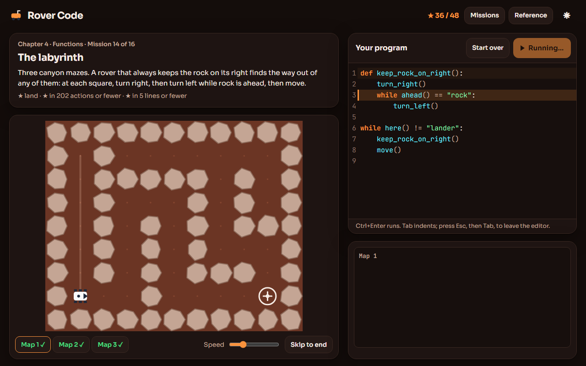

# Rover Code



A programming game. Your rover is on Mars, far from the lander, and the only way to drive it is to write a
program in real Python. Pick up the rock samples, steer clear of rocks and craters, and land.

- **16 missions in four chapters**: First drive (one command per line), Loops (`for`), Sensors (`while`, `if`,
  `else`) and Functions (`def`). Each mission teaches one idea and says it in plain words.
- **Real Python 3**, running in your browser with [Pyodide](https://pyodide.org). The whole language works:
  variables, lists, your own functions, `print()` to the rover log. Errors are Python's own, on the right line
  ("NameError: name 'mvoe' is not defined. Did you mean: 'move'?").
- **Programs that think, not count**: later missions run your program on two or three maps at once, so it has
  to look around with `ahead()` and `here()` instead of counting squares. The labyrinth and the field are
  generated, and the final mission asks for a real maze-walking algorithm.
- **Watch it run**: the replay drives the rover square by square and highlights the line of code doing it. Change
  the speed, skip to the end, or look at each map's run.
- **Three stars per mission**: land; use no more actions (moves, turns, picks) than par; write no more lines than
  par. Pars come from reference solutions that the tests run.
- A code editor with Python highlighting and indenting (CodeMirror), a Python reference, light and dark themes,
  works on phones. Your programs and stars stay in this browser's `localStorage`; nothing is sent anywhere. The replay respects
  your system's reduced-motion setting.

## The rover's functions

| Function | What it does |
| --- | --- |
| `move()` | One square forward. Rocks, craters and the map's edge end the run. |
| `turn_left()`, `turn_right()` | A quarter turn on the spot. |
| `pick()` | Takes the sample under the rover on board. |
| `ahead()` | What is in front: `"clear"`, `"rock"`, `"crater"`, `"sample"`, `"lander"` or `"edge"`. |
| `here()` | What is under the rover: `"clear"`, `"sample"` or `"lander"`. |
| `samples_left()` | How many samples are still out there. |
| `facing()` | `"N"`, `"E"`, `"S"` or `"W"`. |

## How it works

`src/rover.py` is the world: the map, the rover and the functions above. A Web Worker
(`src/python.worker.ts`) runs your program there against every map of the mission and sends back each step
with the line that made it; the page then replays it on a canvas. A runaway loop is stopped by a limit on moves
and lines in Python, and by replacing the worker if it still does not answer. Catching a crash or a limit with
`try`/`except` does not save the run: the rover stays stopped, and the result says why (a program that keeps
looping without the rover after that ends at the worker's time limit instead). Pyodide is served from this
App's own files (copied from the `pyodide` npm package at build time), never from a CDN.

The tests (`npm test`) run `src/rover.py` in the real Pyodide: every mission's reference solution lands on
every map at par, multi-map missions cannot be passed by replaying the first map's moves, and crashes, Python
errors, runaway programs, `try`/`except` around a crash, `input()`, `print()` and the sensors behave as
described. Scoring and saved progress (including broken or old saved data) have their own tests.

## Run

```sh
npm ci
npm run dev      # development server
npm test         # missions and rover tests, in Pyodide
npm run lint     # oxlint
npm run pars     # prints each mission's par from its reference solution
npm run build    # type-check and build to dist/ (about 14 MB, almost all of it Python)
```

Requires Node 22.18 or later (22, 24 or 26+), which runs the TypeScript scripts directly.

## Licence

MIT, © 2026 iSquare Labs. Pyodide is MPL-2.0.
